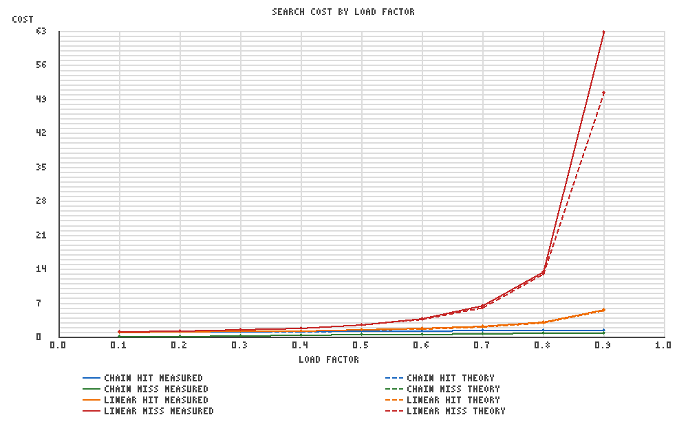

# 해시 테이블 충돌 해결 비교

[https://github.com/minjae-18/algorithms-hw2-Public](https://github.com/minjae-18/algorithms-hw2-Public)

**체이닝과 선형 탐지 · 실험 보고서 · 이슈 #8**

2026년 11월 27일

## 구현 및 실험 방법

두 구현은 문자열 키에 Horner 롤링 해시 `h = (31h + 문자 코드 포인트) mod 용량`을
적용한다. 체이닝은 각 버킷의 연결 리스트를 순회하고, 선형 탐지는 해시 위치에서
시작해 다음 슬롯을 순환하며 빈 칸 또는 일치 키를 찾는다. 두 구현 모두 배열과
직접 만든 노드/엔트리를 사용하며, 구현 코드에서 내장 `dict`, `set`, `hash()`는
사용하지 않는다. 선형 탐지에서 충돌이 나면 `(인덱스 + 1) mod 용량`으로 이동하고,
테이블 용량을 늘릴 때 저장 항목을 다시 배치한다.

용량은 8,192로 고정하고 적재율 α=0.1~0.9마다 같은 결정적 키 집합을 두 테이블에
삽입했다(난수 시드 8,202,611). 각 적재율에서 성공 검색과 별도 부재 키 검색의
평균 비교 노드/슬롯 수를 측정했다. 아래 표는 `실측 / 이론`이며, α는 한 자리로
반올림한 값이다.

| α | 체이닝 성공 | 체이닝 실패 | 선형 성공 | 선형 실패 |
|---:|---:|---:|---:|---:|
| 0.1 | 1.044 / 1.050 | 0.099 / 0.100 | 1.051 / 1.056 | 1.117 / 1.117 |
| 0.2 | 1.105 / 1.100 | 0.195 / 0.200 | 1.136 / 1.125 | 1.287 / 1.281 |
| 0.3 | 1.162 / 1.150 | 0.295 / 0.300 | 1.240 / 1.214 | 1.543 / 1.520 |
| 0.4 | 1.205 / 1.200 | 0.392 / 0.400 | 1.338 / 1.333 | 1.857 / 1.888 |
| 0.5 | 1.259 / 1.250 | 0.496 / 0.500 | 1.528 / 1.500 | 2.561 / 2.500 |
| 0.6 | 1.312 / 1.300 | 0.605 / 0.600 | 1.824 / 1.750 | 3.780 / 3.625 |
| 0.7 | 1.358 / 1.350 | 0.701 / 0.700 | 2.266 / 2.166 | 6.542 / 6.054 |
| 0.8 | 1.406 / 1.400 | 0.796 / 0.800 | 3.181 / 2.999 | 13.417 / 12.991 |
| 0.9 | 1.457 / 1.450 | 0.895 / 0.900 | 5.731 / 5.495 | 62.851 / 50.402 |

## 체이닝 vs 선형 탐지 비교 결과 해석

균등 해싱 가정에서 체이닝의 성공 검색 비용은 `1 + α/2`, 실패 검색은 `α`이다.
선형 탐지의 표준 근사식은 성공 `½ × (1 + 1/(1 - α))`, 실패
`½ × (1 + 1/(1 - α)²)`이다. 이 식들은 이상적인 해시 분포에 대한 기대값이므로
유한한 키 집합의 실측과 완전히 일치하지 않는다.

체이닝은 전체 적재율 범위에서 이론값에 가깝다. 선형 탐지는 적재율이 높아질수록
연속 점유 구간인 **1차 클러스터링**이 커져 탐색 비용이 급격히 오른다. α=0.9에서
실패 검색은 이론 50.402회보다 실측 62.851회(약 24.7% 높음), 성공 검색은
이론 5.495회보다 5.731회로 높았다. 낮은 적재율에서는 두 방식 모두 이론 근사와
가깝지만, 높은 적재율에서는 특히 선형 탐지의 부재 키 검색이 민감하다.

## 진행 과정에서 AI 에이전트가 틀렸거나 수정이 필요했던 부분

초기 제출물은 A4 두 쪽 분량과 실험 해석은 갖췄지만, AI 에이전트의 오류·수정
과정을 별도 항목으로 기록하지 않았다. 또한 실험 스크립트는 Markdown과 그래프만
생성해 제출에 필요한 `results.csv`를 남기지 않았다. 페이지 수와 그래프가 있다는
이유만으로 제출 기준을 모두 충족했다고 판단하면 안 된다는 점을 확인해, 스크립트가
실측·이론 데이터를 함께 CSV로 출력하도록 수정하고 이 누락과 보완 사항을 보고서에
명시했다. 수치 해석도 이론식과 실측을 구분해, 유한한 표본에서 나온 실측을 이론값인
것처럼 서술하지 않도록 정리했다.

## 시각화 및 테스트 검증

`/table` 테스트는 두 전략의 선택 및 대체 테이블 렌더링, Horner 문자별 계산,
선형 탐지의 홈 슬롯과 실제 조사 순서(슬롯 7에서 0으로 랩어라운드)를 확인했다.
전체 테스트 **41/41 통과**. 경계 조건 테스트에는 선형 탐지의 랩어라운드와
가득 찬 테이블에서의 확장도 포함된다. 재현 명령은 `make experiment`이며,
실험 결과는 `experiments/results.csv`에도 기록된다.

그래프 원본: [`probe_experiment.png`](experiments/probe_experiment.png) ·
벡터 그래프: [`probe_experiment.svg`](experiments/probe_experiment.svg) ·
실험 표: [`probe_experiment.md`](experiments/probe_experiment.md)
